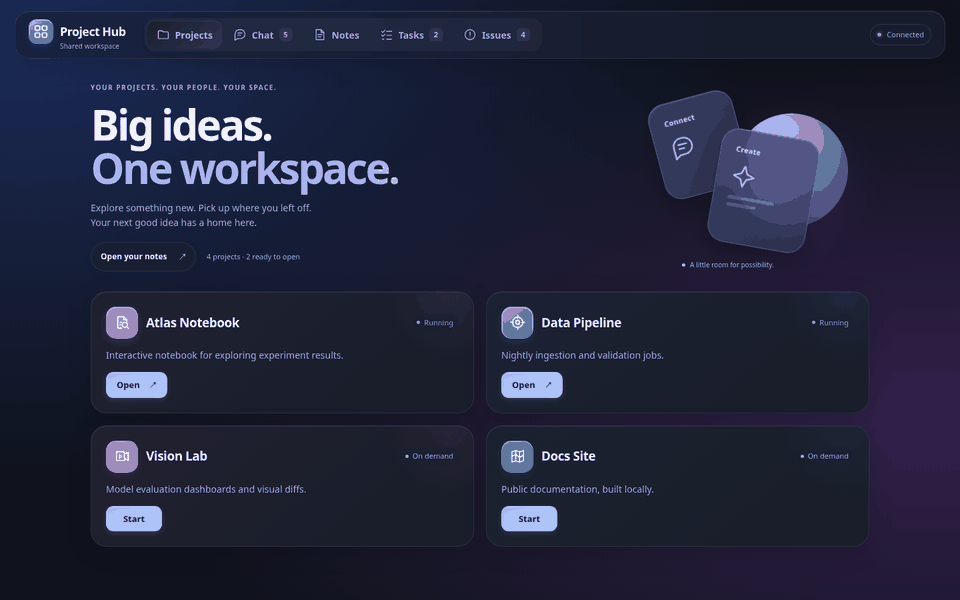
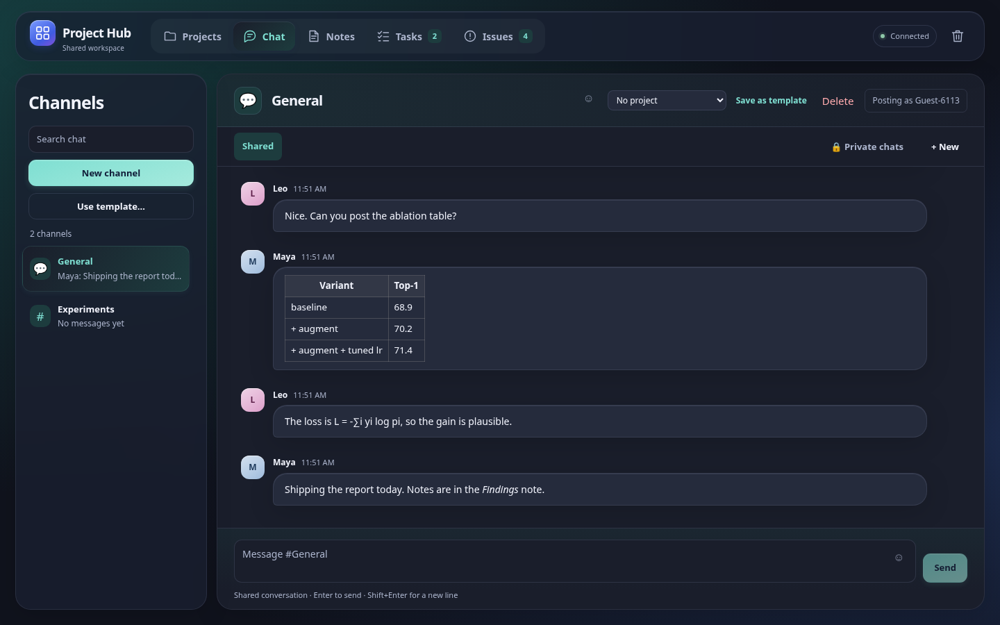
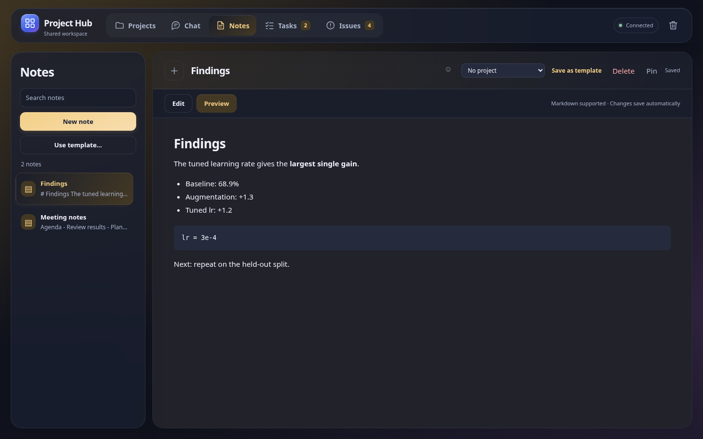
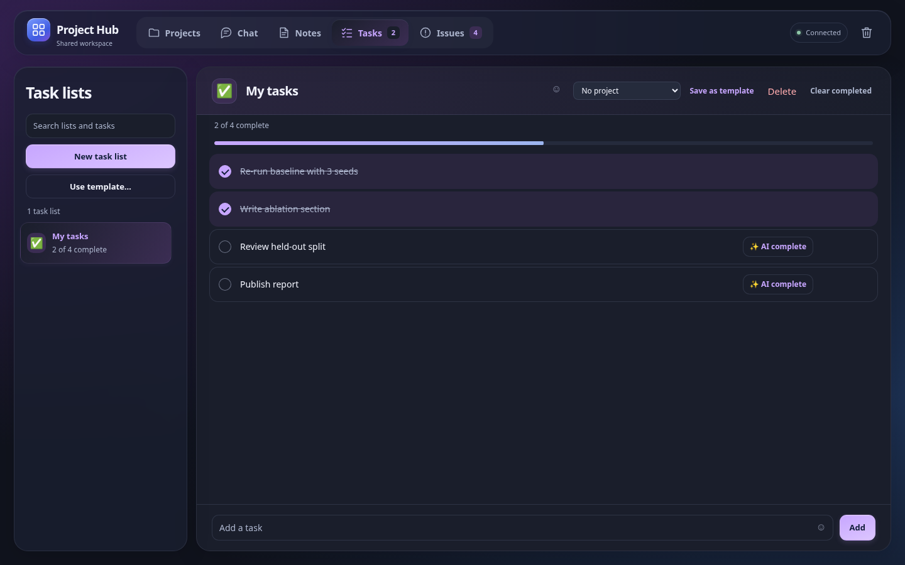
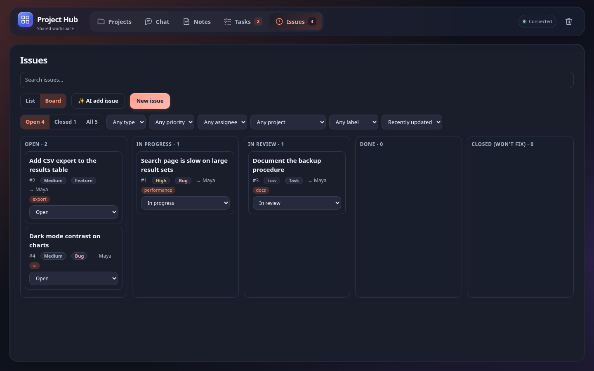

<div align="center">

# Project Hub

### Big ideas. One workspace.

**Chat, notes, tasks and issues, plus a launcher for your local projects and optional AI agents, in one fast, self-hosted page.**

[](LICENSE)


<sub>Run it with one command: <code>python3 server.py</code></sub>

</div>

---

## Why Project Hub

- **Zero setup friction.** No database server, no build step, no third-party Python packages. Just `python3`.
- **One place for the whole loop.** Talk it through, write it down, track it, ship it.
- **Your data, your machine.** Everything lives in plain files under `data/`. Back up one folder.
- **Launch your projects.** Cards start and open your local apps on demand.
- **Bring an agent (optional).** Hand a task to a private AI thread and follow the conversation.

## Take the tour

<div align="center">

</div>

<table>
<tr>
<td width="50%"><b>Chat</b><br>Channels, drafts, markdown, tables and math.<br></td>
<td width="50%"><b>Notes</b><br>Markdown with preview, autosave and conflict detection.<br></td>
</tr>
<tr>
<td width="50%"><b>Tasks</b><br>Lists with progress, priority stars and undo.<br></td>
<td width="50%"><b>Issues</b><br>List and board views, filters, labels, comments, and an <code>AI add issue</code> flow.<br></td>
</tr>
</table>

<sub>Screenshots use a fictional demo workspace. They are generated by `docs/media/capture.py`.</sub>

## Works with

| Agent backend | Status |
| --- | --- |
| [GitHub Copilot CLI](https://docs.github.com/copilot/concepts/agents/about-copilot-cli) | Supported today |
| Claude Code, Codex, Gemini and others | Not supported yet. Tracked in issue #15 (provider abstraction) |

The workspace itself (chat, notes, tasks, issues, launcher) needs no agent at all.

## Features

- **Chat** – channels with drafts, an outbox that survives reloads, unread badges. Agent and user messages render markdown (`**bold**`, `# headings`, lists, code, links) and math (`$E=mc^2$`, `$$\frac{a}{b}$$`).
- **Notes** – markdown with preview, autosave, conflict detection so two people never silently overwrite each other.
- **Tasks** – lists with progress, priority stars, undo and clear-completed.
- **Issues** – report bugs, features, tasks and questions; triage with status, priority, assignee, labels and due dates; discuss in markdown comments; follow an activity history through to done. List and board views, search, filters and sorting. Stored in `data/issues.json`.
- **Icons** – pick an emoji icon for any channel, note or task list, and use the ☺ button in any text field to insert emoji.
- **Templates** – start from built-ins or save your own.
- **Trash** – deleted items (and their messages/tasks) are recoverable.
- **Project launcher** – cards that start and open local apps on demand.
- **Private AI threads (optional)** – hand a task to a GitHub Copilot CLI agent and follow the conversation.

## Quick start

```bash
git clone https://github.com/nadavo11/project-hub.git
cd project-hub
python3 server.py            # then open http://127.0.0.1:8765/
```

Run it permanently as a systemd user service (starts at login, restarts on failure):

```bash
./install.sh                 # dashboard on localhost
./install.sh --agents        # also the AI-thread coordinator
./install.sh --lan           # reachable from other devices (see Security)
```

`python3 launch.py` starts the service if needed and opens your browser.

Requirements: Python 3 (developed on 3.12), Linux with systemd for the service (the server itself runs anywhere Python does). The agent feature additionally needs the [Copilot CLI](https://docs.github.com/copilot/concepts/agents/about-copilot-cli).

## Using it

| Where | What to do |
| --- | --- |
| Header tabs | Switch between Projects, Chat, Notes, Tasks, Issues. The trash icon opens recoverable deletions. |
| Left list | Search, create (**New …**) or **Use template…**. |
| Title bar | Click the icon square to choose or remove an icon; edit the name inline. |
| Project badge | Pick a **Project** in the title bar of a note, task list or chat channel, or in an issue's form/sidebar. The badge shows in lists; agents started from it are told the project and run in its directory (registry: `projects.py`). |
| Any text field | Click ☺ to insert an emoji at the cursor. |
| Notes | Edit/Preview toggle, Pin, **Ctrl/⌘+S** to save now. Everything else autosaves. |

Links are shareable: `#chat/3`, `#notes/7`, `#tasks/1`.

## Configuration

| Setting | Default | Meaning |
| --- | --- | --- |
| `python3 server.py --port N` | `8765` | HTTP port |
| `PROJECT_HUB_HOST` | `0.0.0.0` when run directly; `127.0.0.1` via `install.sh` | Interface to bind |
| `HUB_AGENT_WORKERS` | `3` | Parallel agent jobs (1–16) |
| `HUB_COPILOT` | `~/.local/bin/copilot` | Path to the Copilot CLI |
| `HUB_AGENT_CWD` | `$HOME` | Working directory for agents |

Your data lives in `data/` (git-ignored): `workspace.json` (with a `.bak`) and `data/agents/` (SQLite + operator key). Back up that folder.

### Project cards

The launcher cards are defined in `Launcher` in `server.py` and point at local folders. They show as "unavailable" if the folder is missing. Edit or remove them to suit your machine; the workspace (chat/notes/tasks) works without them.

## Security

The workspace API has **no login**: anyone who can reach the port can read and edit it. Keep the default `127.0.0.1` binding unless you are on a trusted network or behind a reverse proxy with authentication. Agent endpoints are separate and require the operator key stored in `data/agents/operator.key` (mode 0600). Never commit `data/` or `.env`.

## How it works

See [docs/HOW_IT_WORKS.md](docs/HOW_IT_WORKS.md) for the architecture, data model, API and sync/conflict rules.

## Development

```bash
make test        # backend tests, stdlib only
make test-ui     # browser tests: pip install playwright; needs Chrome (HUB_TEST_CHROME to override path)
```

Layout:

```
server.py        HTTP server, workspace store, project launcher
agent_chat.py    durable private-thread store (SQLite)
agent_worker.py  coordinator that runs Copilot CLI per thread
launch.py        start service + open browser
static/          index.html, app.js (projects), workspace.js (chat/notes/tasks), agent-chat.js, markdown.js (safe md + math renderer), CSS
systemd/         unit templates used by install.sh
test_*.py        unit and browser tests
```
